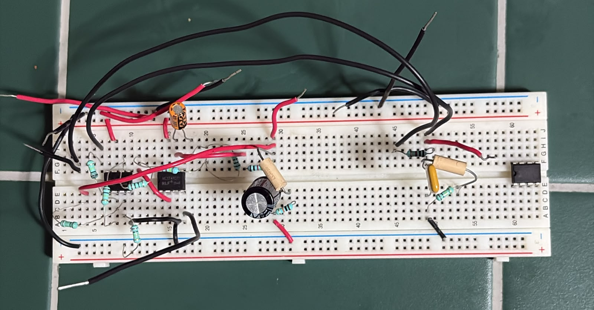
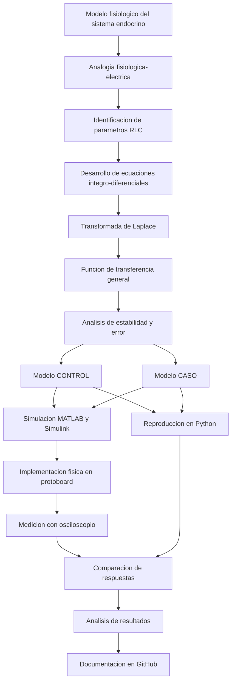

[](https://matlab.mathworks.com/open/github/v1?repo=23212203-EJB/MSFP4)

# Práctica 4 - Sistema endocrino

Repositorio académico de la asignatura **Modelado de Sistemas
Fisiológicos**, correspondiente al programa de **Ingeniería Biomédica**
del Tecnológico Nacional de México / Instituto Tecnológico de Tijuana.
Esta práctica integra modelado matemático, analogías eléctricas de
sistemas fisiológicos, análisis de estabilidad, diseño de controladores
PID, simulación computacional y comprobación experimental.

El caso de estudio representa el comportamiento del **sistema
endocrino** mediante un circuito RLC de segundo orden. Se busca
reproducir y comparar la respuesta del sistema ante diferentes
condiciones fisiológicas: **CONTROL (función normal)** y **CASO
(síndrome de Cushing o hipercortisolismo)**, considerando las
diferencias en el almacenamiento, transporte, respuesta y eliminación
hormonal.

**Docente:** Dr. Paul Antonio Valle Trujillo\
**Correo:** paul.valle@tectijuana.edu.mx\
**Departamento:** Ingeniería Eléctrica y Electrónica\
**Institución:** Tecnológico Nacional de México / Instituto Tecnológico
de Tijuana\
**Asignatura:** Modelado de Sistemas Fisiológicos\
**Programa:** Ingeniería Biomédica\
**Estudiante:** Ernesto Jáuregui Bogarin · 23212203 ·
L23212203@tijuana.tecnm.mx

**Repositorio:** MSFP4\
**Sede:** Blvd. Alberto Limón Padilla s/n, Tijuana, C. P. 22454, B. C.,
México.

------------------------------------------------------------------------

<a id="contenido"></a> 
## Contenido

1.  [Resumen](#resumen)
2.  [Competencia y objetivos](#objetivos)
3.  [Relación con el temario](#temario)
4.  [Modelo fisiológico y analogía eléctrica](#analogia)
5.  [Formulación matemática](#modelo)
6.  [Análisis de estabilidad y error en estado estacionario](#analisis)
7.  [Señal de entrada y condiciones de simulación](#senales)
8.  [Implementación en MATLAB y Simulink](#matlab)
9.  [Reproducción en Python](#python)
10. [Implementación física del circuito RLC](#circuito)
11. [Resultados y comparación de respuestas](#resultados)
12. [Diagrama del sistema endocrino](#diagrama)
13. [Flujo de trabajo](#flujo)
14. [Actividades del estudiante](#actividades)
15. [Estructura del repositorio](#estructura)
16. [Requisitos](#requisitos)
17. [Reproducibilidad y entregables](#reproducibilidad)
18. [Referencias](#referencias)

------------------------------------------------------------------------

<a id="resumen"></a> 
## Resumen

La práctica tiene como propósito **modelar, analizar y simular el
comportamiento del sistema endocrino** mediante una analogía entre un
modelo fisiológico y un circuito eléctrico RLC de segundo orden.

El caso de estudio contempla dos condiciones fisiológicas: **CONTROL
(función normal)** y **CASO (síndrome de Cushing o hipercortisolismo)**.
Para representar ambas condiciones se utiliza una estructura eléctrica
equivalente, modificando los valores de la capacitancia y la resistencia
asociada a la utilización y eliminación del cortisol.

El desarrollo matemático permite obtener las ecuaciones
integro-diferenciales del sistema, establecer su función de
transferencia y analizar su estabilidad en lazo abierto, así como el
error en estado estacionario correspondiente a cada condición.

Posteriormente, se implementan los modelos en MATLAB/Simulink y se
reproducen sus respuestas mediante Python. Adicionalmente, se realiza el
montaje físico de los circuitos eléctricos en un protoboard,
incorporando un controlador PID para la condición CASO y utilizando un
osciloscopio para medir las señales de salida. Finalmente, se comparan
los resultados obtenidos mediante las simulaciones y las mediciones
experimentales.

**Palabras clave:** sistema endocrino; síndrome de Cushing;
hipercortisolismo; circuito RLC; analogía eléctrica; función de
transferencia; ecuaciones integro-diferenciales; controlador PID;
estabilidad; MATLAB; Simulink; Python; protoboard; osciloscopio.

[Volver al contenido](#contenido)

------------------------------------------------------------------------

<a id="objetivos"></a> 
## Competencia y objetivos

### Competencia a desarrollar

Comprender y aplicar los fundamentos del modelado de sistemas
fisiológicos mediante analogías entre sistemas biológicos y eléctricos,
utilizando herramientas matemáticas, computacionales y experimentales
para analizar el comportamiento dinámico de un sistema endocrino bajo
diferentes condiciones fisiológicas.

### Objetivo general

Analizar y simular el comportamiento de un modelo matemático del sistema
endocrino mediante su representación en un circuito eléctrico RLC de
segundo orden, comparando las respuestas correspondientes a una
condición fisiológica normal y una condición de síndrome de Cushing, así
como implementar físicamente los circuitos y evaluar su comportamiento
mediante instrumentación electrónica.

### Objetivos específicos

-   Identificar los elementos fisiológicos que intervienen en la
    regulación hormonal del sistema endocrino.
-   Establecer la analogía entre las variables fisiológicas y los
    elementos del circuito eléctrico equivalente.
-   Obtener las ecuaciones integro-diferenciales que describen el
    comportamiento del sistema.
-   Obtener la función de transferencia mediante la transformada de
    Laplace.
-   Analizar la estabilidad del sistema en lazo abierto para las
    condiciones CONTROL y CASO.
-   Determinar el error en estado estacionario correspondiente a ambas
    condiciones.
-   Implementar los modelos matemáticos en MATLAB/Simulink.
-   Reproducir las respuestas de los modelos mediante Python.
-   Diseñar e implementar un controlador PID para el circuito eléctrico
    correspondiente al CASO.
-   Construir físicamente los circuitos eléctricos en un protoboard.
-   Medir las señales de salida mediante un osciloscopio.
-   Comparar los resultados obtenidos mediante simulaciones
    computacionales y mediciones experimentales.

[Volver al contenido](#contenido)

------------------------------------------------------------------------

<a id="temario"></a> 
## Relación con el temario

La práctica integra contenidos de la asignatura **Modelado de Sistemas
Fisiológicos (IBF-1020)**, relacionando los fundamentos del modelado
matemático de sistemas fisiológicos con el análisis de circuitos
eléctricos y herramientas de simulación y experimentación.

  -----------------------------------------------------------------------
  Área                                Contenidos aplicados
  ----------------------------------- -----------------------------------
  Modelado de sistemas fisiológicos   Representación del sistema
                                      endocrino

  Fisiología                          Regulación hormonal y síndrome de
                                      Cushing

  Circuitos eléctricos                Circuitos RLC de segundo orden

  Análisis matemático                 Ecuaciones integro-diferenciales

  Transformada de Laplace             Obtención de funciones de
                                      transferencia

  Ingeniería de Control               Análisis de estabilidad y error en
                                      estado estacionario

  Control automático                  Diseño e implementación de
                                      controladores PID

  Simulación computacional            MATLAB, Simulink y Python

  Instrumentación electrónica         Implementación en protoboard y
                                      mediciones con osciloscopio
  -----------------------------------------------------------------------

El enfoque combina **Ingeniería Biomédica, Electrónica, Ingeniería de
Control, Ciencias de la Computación y Fisiología**, de acuerdo con la
competencia general de la asignatura.

[Volver al contenido](#contenido)

------------------------------------------------------------------------

<a id="analogia"></a> 
## Modelo fisiológico y analogía eléctrica

### 1. Modelo fisiológico del sistema endocrino

El sistema endocrino se representa mediante el eje
hipotálamo-hipófisis-suprarrenal (HHS), encargado de regular la
producción y liberación de hormonas relacionadas con la respuesta
fisiológica del organismo.

El modelo contempla la interacción entre los siguientes elementos:

| Elemento fisiológico | Representación | Descripción |
|---|---|---|
| Hipotálamo | Fuente de señal | Libera la hormona liberadora de corticotropina (CRH). |
| Hipófisis anterior | Etapa de regulación | Libera la hormona adrenocorticotrópica (ACTH). |
| Glándula suprarrenal | Órgano de respuesta | Participa en la producción y liberación de cortisol. |
| Transporte hormonal | Resistencia $R_1$ | Representa las pérdidas u oposición al transporte de CRH/ACTH. |
| Almacenamiento hormonal | Capacitancia $C$ | Representa el almacenamiento temporal de hormonas en sangre o compartimentos. |
| Respuesta del órgano diana | Inductancia $L$ | Representa la inercia o retardo de la respuesta de la corteza suprarrenal. |
| Utilización y eliminación | Resistencia $R_2$ | Representa la utilización, disipación o eliminación del cortisol. |

El modelo también contempla la retroalimentación negativa del cortisol
sobre los centros de regulación hormonal.

### 2. Condiciones fisiológicas analizadas

Se consideran dos condiciones del sistema endocrino:

**CONTROL (función normal)**

Representa el comportamiento de referencia del sistema endocrino,
caracterizado por:

-   Secreción y transporte hormonal adecuados.
-   Almacenamiento y respuesta regulada.
-   Retroalimentación negativa efectiva.
-   Respuesta estable y amortiguada.

**CASO (síndrome de Cushing / hipercortisolismo)**

Representa una condición de hipercortisolismo, caracterizada en el
modelo por:

-   Secreción sostenida y elevada de ACTH.
-   Mayor acumulación hormonal, representada mediante un incremento de
    la capacitancia $C$.
-   Menor utilización y eliminación del cortisol, representada mediante
    una disminución de $R_2$.
-   Aumento del nivel de cortisol y sobreestimulación de los órganos
    diana.
-   Retroalimentación negativa disminuida.

### 3. Analogía entre variables y elementos

El sistema endocrino se representa mediante un circuito eléctrico
equivalente utilizando una analogía entre las variables fisiológicas y
eléctricas.

  Sistema fisiológico                             Sistema eléctrico equivalente
  ----------------------------------------------- -------------------------------
  Señal de entrada hormonal $V_e(t)$              Voltaje de entrada
  Respuesta hormonal $V_s(t)$                     Voltaje de salida
  Pérdidas en el transporte hormonal              Resistencia $R_1$
  Almacenamiento temporal de hormonas             Capacitancia $C$
  Inercia o retardo de la respuesta suprarrenal   Inductancia $L$
  Utilización o eliminación del cortisol          Resistencia $R_2$

### 4. Parámetros utilizados

Los parámetros del circuito eléctrico equivalente se agrupan de la
siguiente manera para cada condición:

**CONTROL (función normal)**

| Componente | Valor |
|---|---:|
| $R_1$ | 1 kΩ |
| $R_2$ | 100 kΩ |
| $L$ | 100 mH |
| $C$ | 1 µF |

**CASO (síndrome de Cushing)**

| Componente | Valor |
|---|---:|
| $R_1$ | 1 kΩ |
| $R_2$ | 1 kΩ |
| $L$ | 100 mH |
| $C$ | 1,000 µF |

La principal diferencia paramétrica entre ambas condiciones corresponde
a los valores de la capacitancia $C$ y la resistencia $R_2$.

La capacitancia representa el almacenamiento temporal hormonal, mientras
que la resistencia $R_2$ representa la utilización, disipación o
eliminación del cortisol.

[Volver al contenido](#contenido)

------------------------------------------------------------------------

<a id="modelo"></a> 
## Formulación matemática

### 1. Ecuaciones integro-diferenciales

Para describir el comportamiento del circuito RLC equivalente se
establecen las siguientes relaciones entre las corrientes, los voltajes
y los componentes eléctricos.

La corriente de entrada se representa mediante:

```math
F_e(t)=F_c(t)+F_s(t)
```

Aplicando la ley de Ohm:

```math
F_e(t)=\frac{V_e(t)-V_s(t)}{R_1}
```

La corriente que circula por el capacitor se expresa como:

```math
F_c(t)=C\frac{dV_s(t)}{dt}
```

Para la rama que contiene la inductancia y la resistencia $R_2$:

```math
V_s(t)=L\frac{dF_s(t)}{dt}+R_2F_s(t)
```

Sustituyendo las relaciones anteriores y desarrollando las expresiones
correspondientes, se obtiene la ecuación diferencial del sistema:

```math
\boxed{
R_1LC\frac{d^2V_s(t)}{dt^2}
+
(L+R_1R_2C)\frac{dV_s(t)}{dt}
+
(R_1+R_2)V_s(t)
=
L\frac{dV_e(t)}{dt}+R_2V_e(t)
}
```

Esta expresión describe el comportamiento dinámico del circuito
eléctrico equivalente de segundo orden.

### 2. Función de transferencia general

Aplicando la transformada de Laplace a la ecuación diferencial,
considerando condiciones iniciales nulas, se obtiene:

```math
R_1LCs^2V_s(s)
+
(L+R_1R_2C)sV_s(s)
+
(R_1+R_2)V_s(s)
=
LsV_e(s)+R_2V_e(s)
```

Factorizando las expresiones correspondientes:

```math
V_s(s)
\left[
R_1LCs^2+(L+R_1R_2C)s+(R_1+R_2)
\right]
=
V_e(s)(Ls+R_2)
```

Por lo tanto, la función de transferencia general del sistema es:

```math
\boxed{
G(s)=\frac{V_s(s)}{V_e(s)}
=
\frac{Ls+R_2}
{R_1LCs^2+(L+R_1R_2C)s+(R_1+R_2)}
}
```

Donde:

-   $V_e(s)$: transformada de Laplace del voltaje de entrada.
-   $V_s(s)$: transformada de Laplace del voltaje de salida.
-   $R_1$: resistencia asociada a las pérdidas durante el transporte
    hormonal.
-   $R_2$: resistencia asociada a la utilización y eliminación del
    cortisol.
-   $L$: inductancia asociada a la inercia o retardo de la respuesta.
-   $C$: capacitancia asociada al almacenamiento temporal hormonal.

### 3. Función de transferencia para CONTROL

Para la condición de función normal se utilizan los siguientes
parámetros:

```math
\begin{aligned}
R_1 &= 1\,k\Omega \\
R_2 &= 100\,k\Omega \\
L &= 100\,mH \\
C &= 1\,\mu F
\end{aligned}
```

La función de transferencia correspondiente se obtiene sustituyendo los
parámetros de CONTROL en la función de transferencia general:

```math
G_C(s)=
\frac{(100\,mH)s+100\,k\Omega}
{(1\,k\Omega)(100\,mH)(1\,\mu F)s^2+
[100\,mH+(1\,k\Omega)(100\,k\Omega)(1\,\mu F)]s+
(1\,k\Omega+100\,k\Omega)}
```

### 4. Función de transferencia para CASO

Para la condición de síndrome de Cushing se utilizan los siguientes
parámetros:

```math
\begin{aligned}
R_1 &= 1\,k\Omega \\
R_2 &= 1\,k\Omega \\
L &= 100\,mH \\
C &= 1000\,\mu F
\end{aligned}
```

La función de transferencia correspondiente se obtiene sustituyendo los
parámetros del CASO en la función de transferencia general:

```math
G_A(s)=
\frac{(100\,mH)s+1\,k\Omega}
{(1\,k\Omega)(100\,mH)(1000\,\mu F)s^2+
[100\,mH+(1\,k\Omega)(1\,k\Omega)(1000\,\mu F)]s+
(1\,k\Omega+1\,k\Omega)}
```

Las funciones de transferencia representan las dos condiciones
fisiológicas consideradas en la práctica y permiten comparar el
comportamiento del modelo ante una misma señal de entrada.

[Volver al contenido](#contenido)

------------------------------------------------------------------------

<a id="analisis"></a> 
## Análisis de estabilidad y error en estado estacionario

### 1. Estabilidad en lazo abierto

Para analizar la estabilidad del sistema se considera el denominador de
la función de transferencia general:

```math
R_1LCs^2+(L+R_1R_2C)s+(R_1+R_2)=0
```

Los polos del sistema se obtienen mediante la ecuación cuadrática:

```math
\lambda_{1,2}=
\frac{-b\pm\sqrt{b^2-4ac}}{2a}
```

Donde:

```math
\begin{aligned}
a &= R_1LC \\
b &= L+R_1R_2C \\
c &= R_1+R_2
\end{aligned}
```

**CONTROL**

Utilizando los parámetros:

-   $R_1=1\,k\Omega$
-   $R_2=100\,k\Omega$
-   $L=100\,mH$
-   $C=1\,\mu F$

Se obtienen los siguientes polos:

```math
\begin{aligned}
\lambda_1 &= -1,010.01 \\
\lambda_2 &= -999.99\times10^3
\end{aligned}
```

**CASO**

Utilizando los parámetros:

-   $R_1=1\,k\Omega$
-   $R_2=1\,k\Omega$
-   $L=100\,mH$
-   $C=1000\,\mu F$

Se obtienen los siguientes polos:

```math
\begin{aligned}
\lambda_1 &= -2.0002 \\
\lambda_2 &= -9.9999\times10^3
\end{aligned}
```

De acuerdo con los valores obtenidos, ambos modelos presentan polos con
parte real negativa, por lo que son estables en lazo abierto.

### 2. Error en estado estacionario

Para analizar el error en estado estacionario se considera una entrada
escalón unitario y se utiliza el teorema del valor final.

La expresión correspondiente es:

```math
e_{ss}=
\lim_{s\to0}
s\left[
\frac{1}{s}
\left(1-\frac{V_s(s)}{V_e(s)}\right)
\right]
```

**CONTROL**

Para la condición de función normal, el error en estado estacionario se
expresa como:

```math
e_{ss,C}=1-\frac{R_2}{R_1+R_2}
```

Sustituyendo los valores utilizados:

```math
e_{ss,C}
=
1-\frac{100\,k\Omega}{1\,k\Omega+100\,k\Omega}
```

El resultado obtenido es:

```math
\boxed{
e_{ss,C}=9.9009\times10^{-3}\,V
}
```

**CASO**

Para la condición de síndrome de Cushing, el error en estado
estacionario se expresa como:

```math
e_{ss,A}=1-\frac{R_2}{R_1+R_2}
```

Sustituyendo los valores utilizados:

```math
e_{ss,A}
=
1-\frac{1\,k\Omega}{1\,k\Omega+1\,k\Omega}
```

El resultado obtenido es:

```math
\boxed{
e_{ss,A}=0.5\,V
}
```

### 3. Diferencia entre los errores en estado estacionario

La diferencia entre los resultados obtenidos para ambas condiciones se
expresa mediante:

```math
e(t)=V_{s,CONTROL}(t)-V_{s,CASO}(t)
```

Considerando los valores obtenidos en el análisis:

```math
e(t)=9.9009\times10^{-3}-0.5
```

Por lo tanto:

```math
\boxed{
e(t)=-0.49009\,V
}
```

Estos resultados permiten comparar el comportamiento de las respuestas
en estado estacionario de ambas condiciones fisiológicas.

[Volver al contenido](#contenido)

------------------------------------------------------------------------

<a id="senales"></a> 
## Señal de entrada y condiciones de simulación

La señal utilizada para evaluar el comportamiento de los modelos
corresponde a una **entrada escalón**, representada mediante $V_e(t)$.

Esta señal se aplica a los dos circuitos eléctricos para comparar sus
respectivas respuestas.

  -----------------------------------------------------------------------
  Señal                   Variable                Descripción
  ----------------------- ----------------------- -----------------------
  Entrada escalón         $V_e(t)$                Voltaje de entrada
                                                  aplicado al sistema

  Corriente de entrada    $F_e(t)$                Corriente que circula
                                                  por la resistencia
                                                  $R_1$

  Corriente del capacitor $F_c(t)$                Corriente que circula
                                                  por la capacitancia $C$

  Corriente de salida     $F_s(t)$                Corriente que circula
                                                  por la rama de $L$ y
                                                  $R_2$

  Salida CONTROL          $V_s(t)$                Voltaje de salida del
                                                  circuito de función
                                                  normal

  Salida CASO             $V_s(t)$                Voltaje de salida del
                                                  circuito de síndrome de
                                                  Cushing
                                                  
  -----------------------------------------------------------------------

La simulación permite observar las diferencias entre ambas condiciones
fisiológicas utilizando los parámetros establecidos para cada modelo.

Adicionalmente, se implementa un controlador PID para el circuito
correspondiente al CASO, mientras que el circuito CONTROL permanece en
lazo abierto.

[Volver al contenido](#contenido)

------------------------------------------------------------------------

<a id="matlab"></a> 
## Implementación en MATLAB y Simulink

La implementación computacional se realiza mediante MATLAB y Simulink,
utilizando dos subsistemas principales que representan las condiciones
fisiológicas analizadas.

### 1. Subsistema CONTROL

El primer subsistema representa el comportamiento normal del sistema
endocrino y utiliza los parámetros correspondientes a la condición
CONTROL.

Dentro del subsistema se implementa el circuito RLC equivalente mediante
componentes de Simulink/Simscape y se obtiene la respuesta
correspondiente a la función de transferencia del modelo.

El circuito CONTROL permanece en **lazo abierto**, sin incorporar un
controlador PID.

Se obtiene la respuesta del sistema ante una señal de entrada escalón,
permitiendo observar el comportamiento del circuito eléctrico y de su
función de transferencia.

### 2. Subsistema CASO

El segundo subsistema representa la condición de síndrome de Cushing.
Conserva la estructura general del circuito RLC equivalente, modificando
los parámetros correspondientes al caso estudiado.

A diferencia del modelo CONTROL, este subsistema incorpora un
**controlador PID**, con el propósito de regular la respuesta del
circuito eléctrico.

Se consideran las siguientes etapas:

-   Implementación del circuito RLC correspondiente al CASO.
-   Incorporación del controlador PID.
-   Aplicación de la señal de entrada escalón.
-   Obtención de la respuesta del sistema.
-   Visualización y comparación de las señales mediante bloques Scope.

### 3. Diagrama general de simulación

El modelo general integra los dos subsistemas y permite aplicar una
misma entrada escalón para comparar sus respuestas.

El subsistema CONTROL permite observar el comportamiento del circuito en
lazo abierto, mientras que el subsistema CASO permite evaluar el
comportamiento del circuito con el controlador PID implementado.

Los bloques Scope permiten visualizar las respuestas obtenidas durante
las simulaciones.

[Volver al contenido](#contenido)

------------------------------------------------------------------------

<a id="python"></a> 
## Reproducción en Python

La implementación en Python se realiza mediante **Visual Studio Code**,
con el propósito de reproducir y comparar las respuestas obtenidas en
MATLAB/Simulink.

El programa permite representar las funciones de transferencia
correspondientes a las condiciones CONTROL y CASO, aplicar la señal de
entrada escalón y visualizar las respuestas de los sistemas.

Los principales elementos que se consideran en la implementación son:

1.  Definición de los parámetros del modelo CONTROL.
2.  Definición de los parámetros del modelo CASO.
3.  Construcción de las funciones de transferencia.
4.  Definición de la señal de entrada escalón.
5.  Simulación de las respuestas de ambos modelos.
6.  Generación de gráficas para comparar los resultados.
7.  Almacenamiento de las figuras obtenidas.

Las respuestas generadas mediante Python se utilizan para contrastar el
comportamiento de los modelos con los resultados obtenidos en
MATLAB/Simulink.

[Volver al contenido](#contenido)

------------------------------------------------------------------------

<a id="circuito"></a> 
## Implementación física del circuito RLC

Además de las simulaciones computacionales, la práctica contempla la
construcción física de los circuitos eléctricos equivalentes mediante un
**protoboard**, utilizando los componentes electrónicos correspondientes
a las condiciones CONTROL y CASO.

### 1. Circuito físico CONTROL

Se realiza el montaje del circuito RLC correspondiente a la condición de
función normal, utilizando los valores establecidos para las
resistencias, la inductancia y la capacitancia.

El circuito se mantiene en lazo abierto, sin incorporar un controlador
PID.

Se aplica una señal de entrada escalón y se mide el voltaje de salida
$V_s(t)$ mediante un osciloscopio, con el propósito de observar su
comportamiento dinámico.

### 2. Circuito físico CASO

Se realiza el montaje del circuito RLC correspondiente a la condición de
síndrome de Cushing, modificando los valores de los componentes de
acuerdo con los parámetros establecidos para este modelo.

En esta condición se incorpora un controlador PID para regular la
respuesta del circuito eléctrico.

Se aplica la señal de entrada escalón y se utiliza un osciloscopio para
medir y visualizar la respuesta de salida del circuito con el
controlador implementado.

### 3. Instrumentación y montaje experimental

La implementación física permite contrastar los resultados obtenidos
mediante simulaciones con el comportamiento real de los circuitos
eléctricos.

  Instrumento o componente   Aplicación
  -------------------------- ---------------------------------------------------
  Protoboard                 Construcción de los circuitos eléctricos
  Resistencias               Representación de $R_1$ y $R_2$
  Capacitor                  Representación de $C$
  Inductor                   Representación de $L$
  Controlador PID            Regulación del circuito correspondiente al CASO
  Osciloscopio               Visualización y medición de las señales de salida

**Montaje físico del circuito eléctrico:**



`<sub>`{=html}Figura. Implementación física del circuito eléctrico
equivalente del sistema endocrino.`</sub>`{=html}

[Volver al contenido](#contenido)

------------------------------------------------------------------------

<a id="resultados"></a> 
## Resultados y comparación de respuestas

Los resultados de la práctica permiten comparar el comportamiento del
sistema endocrino bajo las dos condiciones fisiológicas establecidas,
considerando tanto las simulaciones computacionales como las mediciones
experimentales.

### 1. Resultados de CONTROL

Se presenta la respuesta del modelo correspondiente a la función normal
del sistema endocrino, utilizando los parámetros establecidos para el
circuito RLC.

El circuito permanece en lazo abierto y permite observar el
comportamiento de la señal de salida ante una entrada escalón.

Se consideran los resultados obtenidos mediante MATLAB/Simulink, Python
y el montaje físico en protoboard.

### 2. Resultados de CASO

Se presenta la respuesta del modelo correspondiente al síndrome de
Cushing, utilizando los parámetros establecidos para el circuito RLC.

En esta condición se incorpora un controlador PID para regular la
respuesta del sistema.

Se consideran los resultados obtenidos mediante MATLAB/Simulink, Python
y el montaje físico en protoboard.

### 3. Comparación entre condiciones

La comparación de ambas respuestas permite observar la influencia de los
cambios paramétricos del circuito sobre el comportamiento dinámico del
modelo.

Se consideran los siguientes aspectos para el análisis:

-   Diferencias entre las respuestas de CONTROL y CASO.
-   Comportamiento de las salidas obtenidas mediante los circuitos
    eléctricos equivalentes.
-   Comparación entre las respuestas de las funciones de transferencia.
-   Influencia de los valores de capacitancia y resistencia sobre la
    respuesta del sistema.
-   Comparación entre el circuito CONTROL en lazo abierto y el circuito
    CASO con controlador PID.
-   Concordancia entre los resultados obtenidos en MATLAB/Simulink y
    Python.
-   Comparación entre las simulaciones computacionales y las mediciones
    experimentales realizadas con el osciloscopio.

**Resultados del estudiante:** incorporar las gráficas obtenidas en las
simulaciones y una interpretación de las diferencias observadas entre
ambas condiciones.

[Volver al contenido](#contenido)

------------------------------------------------------------------------

<a id="diagrama"></a> 
## Diagrama del sistema endocrino

A continuación, se presenta una representación gráfica del sistema
endocrino, elaborada en **BioRender**, que permite visualizar los
elementos fisiológicos involucrados y su relación con las dos
condiciones estudiadas.

El diagrama contempla las siguientes representaciones:

-   **CONTROL:** función normal del sistema endocrino, con secreción y
    transporte hormonal adecuados, almacenamiento regulado y
    retroalimentación negativa efectiva.
-   **CASO:** síndrome de Cushing (hipercortisolismo), representado
    mediante una mayor acumulación hormonal, menor utilización y
    eliminación del cortisol y una respuesta hormonal elevada.
-   **Equivalencia fisiológica-eléctrica:** correspondencia entre los
    elementos del eje hipotálamo-hipófisis-suprarrenal y los componentes
    del circuito RLC.

La ilustración permite complementar el modelo matemático y la analogía
eléctrica, facilitando la interpretación de los cambios fisiológicos
asociados a las condiciones CONTROL y CASO.


`<sub>`{=html}Figura. Representación del sistema endocrino y su modelo
eléctrico equivalente en condiciones CONTROL y CASO (síndrome de
Cushing). Elaboración propia mediante BioRender.`</sub>`{=html}

[Volver al contenido](#contenido)

------------------------------------------------------------------------

<a id="flujo"></a> 
## Flujo de trabajo



El procedimiento integra el análisis matemático, la representación
mediante circuitos eléctricos equivalentes, la simulación computacional
y la comprobación experimental de las dos condiciones fisiológicas.

[Volver al contenido](#contenido)

------------------------------------------------------------------------

<a id="actividades"></a> 
## Actividades del estudiante

La práctica contempla las siguientes actividades para el desarrollo y
análisis del modelo matemático:

### Etapa 1. Modelo fisiológico y analogía eléctrica

-   [ ] Identificar los elementos fisiológicos del sistema endocrino.
-   [ ] Establecer la correspondencia entre las variables fisiológicas y
    eléctricas.
-   [ ] Identificar los elementos del circuito RLC equivalente.
-   [ ] Registrar los parámetros correspondientes a CONTROL y CASO.

### Etapa 2. Desarrollo matemático

-   [ ] Establecer las ecuaciones integro-diferenciales del sistema.
-   [ ] Aplicar las relaciones correspondientes a las leyes de
    Kirchhoff.
-   [ ] Obtener la ecuación diferencial del circuito.
-   [ ] Aplicar la transformada de Laplace.
-   [ ] Obtener la función de transferencia general.
-   [ ] Identificar las funciones de transferencia de CONTROL y CASO.
-   [ ] Determinar los polos de ambos modelos.
-   [ ] Analizar la estabilidad en lazo abierto.
-   [ ] Determinar el error en estado estacionario de ambas condiciones.

### Etapa 3. Simulación computacional

-   [ ] Implementar el modelo CONTROL en Simulink.
-   [ ] Implementar el modelo CASO en Simulink.
-   [ ] Aplicar la señal de entrada escalón.
-   [ ] Obtener las respuestas de los circuitos eléctricos equivalentes.
-   [ ] Obtener las respuestas de las funciones de transferencia.
-   [ ] Diseñar e implementar el controlador PID para el CASO.
-   [ ] Reproducir los modelos mediante Python.
-   [ ] Generar y almacenar las gráficas correspondientes.

### Etapa 4. Implementación física

-   [ ] Construir el circuito CONTROL en protoboard.
-   [ ] Construir el circuito CASO en protoboard.
-   [ ] Implementar el controlador PID correspondiente al CASO.
-   [ ] Aplicar la señal de entrada escalón a los circuitos.
-   [ ] Medir la respuesta de salida del circuito CONTROL mediante el
    osciloscopio.
-   [ ] Medir la respuesta de salida del circuito CASO con el
    controlador PID mediante el osciloscopio.
-   [ ] Registrar las mediciones experimentales.

### Etapa 5. Comparación y documentación

-   [ ] Comparar las respuestas de CONTROL y CASO.
-   [ ] Contrastar los resultados de MATLAB/Simulink y Python.
-   [ ] Comparar los resultados de simulación con las mediciones
    experimentales.
-   [ ] Interpretar las diferencias entre las dos condiciones
    fisiológicas.
-   [ ] Incorporar el diagrama del sistema endocrino elaborado en
    BioRender.
-   [ ] Incorporar las gráficas y evidencias experimentales.
-   [ ] Documentar los resultados en el repositorio de GitHub.

[Volver al contenido](#contenido)

------------------------------------------------------------------------

<a id="estructura"></a> 
## Estructura del repositorio

Los archivos de la práctica se organizan en la carpeta principal del
repositorio:

``` text
MSFP4/
│
├── README.md
├── Analisis_matematico.pdf
├── diagrama_sistema_endocrino.png
├── circuito_fisico_endocrino.jpeg
├── modelo_endocrino.py
├── modelo_endocrino.slx
└── demás archivos de la práctica
```

Las imágenes del diagrama del sistema endocrino y del circuito físico se
encuentran en la misma carpeta que el archivo `README.md`. Por lo tanto,
las rutas utilizadas en el documento hacen referencia directamente a sus
nombres de archivo.

[Volver al contenido](#contenido)

------------------------------------------------------------------------

<a id="requisitos"></a> 
## Requisitos

### Software

-   **MATLAB:** para el análisis y procesamiento de los modelos
    matemáticos.
-   **Simulink:** para implementar y simular los circuitos eléctricos
    equivalentes.
-   **Python:** para reproducir las funciones de transferencia y generar
    las gráficas.
-   **Visual Studio Code:** entorno de desarrollo utilizado para
    ejecutar los programas de Python.
-   **Git y GitHub:** para organizar y documentar los archivos de la
    práctica.

### Instrumentación y componentes físicos

-   Protoboard.
-   Resistencias eléctricas.
-   Capacitores.
-   Inductores.
-   Componentes necesarios para la implementación del controlador PID.
-   Osciloscopio.
-   Cables y elementos de conexión.

Las bibliotecas de Python y los componentes electrónicos necesarios
deberán corresponder a los utilizados en los programas y montajes
experimentales de la práctica.

[Volver al contenido](#contenido)

------------------------------------------------------------------------

<a id="reproducibilidad"></a> 
## Reproducibilidad y entregables

### Secuencia de reproducción

1.  Consultar el material de referencia proporcionado para la práctica.
2.  Identificar los elementos fisiológicos del sistema endocrino y su
    analogía eléctrica.
3.  Registrar los parámetros correspondientes a CONTROL y CASO.
4.  Establecer las ecuaciones integro-diferenciales del circuito RLC.
5.  Obtener la función de transferencia general mediante la transformada
    de Laplace.
6.  Identificar las funciones de transferencia correspondientes a las
    dos condiciones fisiológicas.
7.  Analizar la estabilidad y el error en estado estacionario.
8.  Implementar los modelos en MATLAB/Simulink.
9.  Diseñar e implementar el controlador PID para el circuito CASO.
10. Aplicar la entrada escalón y obtener las respuestas de ambos
    modelos.
11. Reproducir los modelos mediante Python.
12. Construir físicamente los circuitos eléctricos en protoboard.
13. Incorporar el controlador PID al circuito correspondiente al CASO.
14. Medir las señales de salida mediante el osciloscopio.
15. Comparar los resultados obtenidos mediante simulaciones y mediciones
    experimentales.
16. Incorporar el diagrama del sistema endocrino y las evidencias
    correspondientes.
17. Publicar los archivos y la documentación en el repositorio de
    GitHub.

### Resultados esperados

  -----------------------------------------------------------------------
  Entregable                          Evidencia
  ----------------------------------- -----------------------------------
  Modelo fisiológico                  Representación del sistema
                                      endocrino

  Analogía eléctrica                  Circuitos RLC y correspondencia de
                                      variables

  Desarrollo matemático               Ecuaciones integro-diferenciales

  Función de transferencia            Expresión general y modelos CONTROL
                                      y CASO

  Análisis del sistema                Estabilidad y error en estado
                                      estacionario

  MATLAB/Simulink                     Modelos de simulación y resultados

  Python                              Código fuente y gráficas de las
                                      respuestas

  Controlador PID                     Implementación para el circuito
                                      CASO

  Circuito físico                     Montajes eléctricos en protoboard

  Instrumentación                     Mediciones de las señales mediante
                                      osciloscopio

  Comparación                         Análisis de simulaciones y
                                      resultados experimentales

  Diagrama                            Ilustración del sistema endocrino
                                      elaborada en BioRender

  Documentación                       README.md y archivos del
                                      repositorio
  -----------------------------------------------------------------------

### Criterios de presentación académica

El repositorio debe permitir identificar claramente el procedimiento
matemático, los parámetros utilizados, las simulaciones computacionales
y los resultados obtenidos mediante la implementación física.

Se debe distinguir entre las condiciones fisiológicas estudiadas y
conservar la correspondencia entre los parámetros del modelo, las
funciones de transferencia, los controladores implementados y las
mediciones experimentales.

[Volver al contenido](#contenido)

------------------------------------------------------------------------

<a id="referencias"></a> 
## Referencias

\[1\] P. A. Valle, *Syllabus para Modelado de Sistemas Fisiológicos*,
Tecnológico Nacional de México / Instituto Tecnológico de Tijuana,
Tijuana, B. C., México. Disponible en: https://biomath.xyz/course/

\[2\] P. A. Valle, *Material de clase y desarrollo matemático de la
Práctica 4: Sistema endocrino*, Modelado de Sistemas Fisiológicos,
Tecnológico Nacional de México / Instituto Tecnológico de Tijuana, 2026.

\[3\] Elaboración propia, *Diagrama fisiológico y eléctrico del sistema
endocrino: comparación entre CONTROL y CASO (síndrome de Cushing)*,
BioRender, 2026.

------------------------------------------------------------------------

## Uso académico

Este repositorio corresponde a la **Práctica 4 de Modelado de Sistemas
Fisiológicos**, cuyo propósito es estudiar el comportamiento de un
modelo matemático del sistema endocrino mediante su representación
eléctrica equivalente utilizando circuitos RLC de segundo orden.

El desarrollo contempla la obtención de ecuaciones
integro-diferenciales, funciones de transferencia y el análisis de
estabilidad de dos condiciones fisiológicas: función normal y síndrome
de Cushing.

Asimismo, se realizan simulaciones computacionales, se implementa un
controlador PID para la condición CASO y se construyen físicamente los
circuitos eléctricos para comparar sus respuestas mediante mediciones
con osciloscopio.

Los resultados permiten relacionar los fundamentos del modelado
matemático, la ingeniería de control y la instrumentación electrónica
con el estudio de sistemas fisiológicos.
